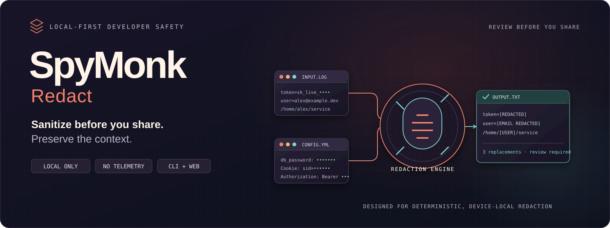

# SpyMonk Redact

**Sanitize before you share. Preserve the context.**

SpyMonk Redact is a local-first redaction engine for the moment between debugging and sharing. It removes likely secrets and personal identifiers from logs, stack traces, configuration fragments, terminal output, and API diagnostics while retaining the surrounding context that makes those artifacts useful.

> **Status — implemented, not released.** The detection engine, the `spymonk-redact` command-line tool, the WebAssembly adapter, the browser playground, the Python wheel, and the release workflows are implemented in this repository, and their test suites pass. Nothing has been published: no package, archive, image, or hosted site exists yet. See [development status](#development-status) for the remaining release gates.

[Product requirements](docs/PRD.md) · [Technical design](docs/TRD.md) · [Rule reference](docs/rules.md) · [Development plans](docs/plans/) · [Installation status](docs/installation/README.md)

## Why it exists

Debugging artifacts routinely contain credentials, tokens, session data, email addresses, private paths, and connection strings. Repository scanners protect source control and CI, but they do not help at the point a developer needs to paste an excerpt into a ticket, pull request, chat, support case, or AI assistant.

SpyMonk Redact is being built as a fast, deterministic local step for that workflow: redact risky values, retain the evidence around them, then review the result before sharing.

## What the engine detects

The current rule manifest defines nine detector families:

| Rule | Coverage | Default |
| --- | --- | --- |
| SR-001 | Named secret values such as `password`, `token`, and `api_key` | On |
| SR-002 | Authorization credentials | On |
| SR-003 | Passwords embedded in URLs | On |
| SR-004 | Usernames in home-directory paths | On |
| SR-005 | Email addresses | On |
| SR-006 | RFC 1918 and IPv6 unique-local addresses | Opt-in |
| SR-007 | Recognized credential formats | On |
| SR-008 | Private-key PEM blocks | On |
| SR-009 | Cookie values | On |

Rules are compiled from [`rules/rules.v1.json`](rules/rules.v1.json) into the core build. The generated [rule reference](docs/rules.md) documents the exact supported formats, placeholders, examples, and exclusions.

## Using the command-line tool

Build it from source (below) until a release is published.

```sh
spymonk-redact app.log > app.redacted.log          # file to standard output
kubectl logs pod/api | spymonk-redact --report     # pipe, with a summary on stderr
spymonk-redact --output clean.log app.log          # atomic file output; stdout stays empty
spymonk-redact --report-format json app.log        # machine-readable report on stderr
spymonk-redact --list-rules                        # the rule catalog
```

Output is byte-exact except for redacted values, in the input's own encoding. On a terminal, hidden and control characters are shown as `<U+XXXX>` markers so escape sequences cannot act on the terminal. Exit codes: 0 success, 1 failure, 2 usage error, 130 or 143 interrupted, 141 broken pipe. To process many files, run one process per file, for example `find logs -name '*.log' -print0 | xargs -0 -P 8 -I{} spymonk-redact -o {}.redacted {}`.

## Current implementation

The workspace contains a `no_std` + `alloc` Rust engine designed for deterministic, bounded streaming processing. It includes:

- UTF-8 and UTF-16 decoding with BOM preservation and explicit error handling;
- chunk-independent line framing that preserves LF, CRLF, and lone-CR separators;
- deterministic candidate overlap resolution and findings ranges;
- a per-line fixed point, so running the engine on its own output changes nothing (a line that never settles is replaced whole and reported with a warning);
- per-rule summaries and hidden-character census data;
- synthetic golden fixtures, property tests for invariants P-1 to P-6, linear-time adversarial tests, and fuzz targets with invariant checks;
- generated Rust rule tables and Markdown rule documentation.

The command-line tool (`crates/cli`) streams input in 64 KiB chunks, writes `--output` files atomically (create-new, private, synced, renamed; never the input file under any spelling), and hardens itself before reading input: no core dumps, a seccomp filter that denies network and process-creation syscalls on Linux, and process mitigation policies on Windows. Its reports validate against [`schemas/report.v1.schema.json`](schemas/report.v1.schema.json) and never contain input content or paths.

A WebAssembly adapter (`crates/wasm`) runs the same engine in the browser. It zeroes its input and output buffers after each job and caps its memory at 512 MiB.

The browser playground (`web/`) sanitizes pasted text and local files entirely on the device. It runs the engine in Web Workers under a strict Content Security Policy with Trusted Types and Subresource Integrity, makes no network requests, and uses no cookies or browser storage.

## Development status

| Area | Status |
| --- | --- |
| M0 foundations and rule compiler | Implemented |
| M1 streaming detection engine | Implemented |
| Golden fixtures, adversarial cases, generated rule docs | Implemented |
| Property invariants P-1 to P-6, including P-4 (idempotence) | Covered by passing tests |
| Fuzzing | Targets implemented; runs in CI on Linux. The 24 CPU-hours per target required for release have not yet accumulated |
| M2 command-line interface and packaging | Implemented: CLI, reports and schema, hardening, Python wheel and launcher, archive and image definitions. Tests pass on Windows locally and run on Linux, macOS, and Windows in CI |
| M3 browser/WebAssembly playground | Implemented; automated tests pass in Chromium, Firefox, and WebKit. Manual screen-reader and real-Safari checks are pending |
| M4 evidence | Evidence register, compliance self-assessments, privacy notice, and threat-model re-review in [`docs/compliance`](docs/compliance/README.md); reference-machine performance runs pending |
| M5 release preparation | Release workflow (signed tags, attestations, rebuild comparison, protected publishing) implemented; owner setup in the [release runbook](docs/release.md) |

The project intentionally does not claim release readiness until all engine properties and release gates pass.

## Local-first by design

The core library has no network, filesystem, process, clock, randomness, or environment access. The browser playground uses the same compiled rules and engine, and the planned CLI will too, so equivalent inputs produce equivalent output.

SpyMonk Redact is not a guarantee that content is safe to share. It complements—not replaces—credential rotation, repository scanning, enterprise DLP, or human review. If a credential has already been exposed, rotate it.

## Building the current workspace

Install the Rust toolchain specified by [`rust-toolchain.toml`](rust-toolchain.toml), then run:

```sh
cargo fmt --all --check
cargo clippy --workspace --all-targets --locked -- -D warnings
cargo test --workspace --locked
```

The test suites cover codecs, framing, detectors, fixtures, properties, adversarial inputs, generated-rule documentation, the WebAssembly adapter, and the CLI (I/O, atomic output, reports, rendering, signals, and parity with the browser paths), under `crates/*/tests/`. The binary is `target/debug/spymonk-redact`, or `target/release/spymonk-redact` after `cargo build --release -p spymonk-redact`.

### Python wheel

```sh
python -m pip install --require-hashes -r python/build-requirements.txt   # pinned maturin
cd python && maturin build --release --locked --out ../wheels
pip install ../wheels/*.whl     # provides spymonk-redact and python -m spymonk_redact
```

### Browser playground

The playground needs Node.js 22.13 or later and `wasm-bindgen-cli` 0.2.129:

```sh
cargo install wasm-bindgen-cli --version 0.2.129 --locked
cd web
npm ci                # install scripts are disabled by web/.npmrc
npm run build         # engine to WebAssembly, type checks, bundle, bundle verification
npm run serve         # http://127.0.0.1:4173/ with the production security headers
```

`npm run lint`, `npm test`, and `npm run e2e` run the linters, the unit tests, and the browser tests (after `npx playwright install`). `npm run dev` starts a development server that does not apply the production headers.

### Optional tooling

Security and fuzz tooling is configured but must be installed separately. Fuzzing needs a nightly toolchain and runs on Linux:

```sh
cargo install cargo-deny --locked
cargo install cargo-fuzz --version 0.12.0 --locked
```

## Repository layout

```text
crates/core/       Streaming redaction engine
crates/rules/      Manifest validation and rule/documentation generator
crates/cli/        The spymonk-redact command-line tool
crates/wasm/       WebAssembly adapter for the browser
python/            Wheel definition and the python -m launcher
packaging/         Container image definition
tools/             Release checks and reproducible packaging
web/               Browser playground (TypeScript and Vite)
rules/             Versioned rule manifest and schema
schemas/           JSON schemas for reports and fixtures
fixtures/          Synthetic positive, negative, overlap, encoding, and benign fixtures
fuzz/              libFuzzer targets
docs/              Product requirements, technical design, rules, and plans
.github/           CI, fuzzing, and dependency-update configuration
assets/            Project artwork
```

## Documentation

| Document | Purpose |
| --- | --- |
| [PRD](docs/PRD.md) | Product scope, users, privacy model, and acceptance criteria. |
| [TRD](docs/TRD.md) | Engine and browser architecture, security model, invariants, and release gates. |
| [Rule reference](docs/rules.md) | Generated detector catalogue and rule details. |
| [M0/M1 implementation plan](docs/plans/2026-10-21-m0-m1-foundations-and-engine.md) | Foundation and engine delivery checklist. |
| [M3 implementation plan](docs/plans/2026-10-21-m3-web.md) | Browser playground delivery checklist. |
| [M2–M5 implementation plan](docs/plans/2026-10-22-m2-m5-cli-packaging-release.md) | CLI, packaging, evidence, and release checklist. |
| [Compliance](docs/compliance/README.md) | Self-assessments, evidence register, and threat-model re-review. |
| [Privacy notice](docs/privacy.md) | What the website and the tool do and do not do with your data. |
| [Release runbook](docs/release.md) | Owner setup and the steps of each release. |
| [Installation status](docs/installation/README.md) | Publication and verification status, and building from source. |

## Contributing

Please read [CONTRIBUTING.md](CONTRIBUTING.md) and [SECURITY.md](SECURITY.md) before opening an issue or proposing a change. Use only synthetic values in tests, fixtures, examples, and reports.
